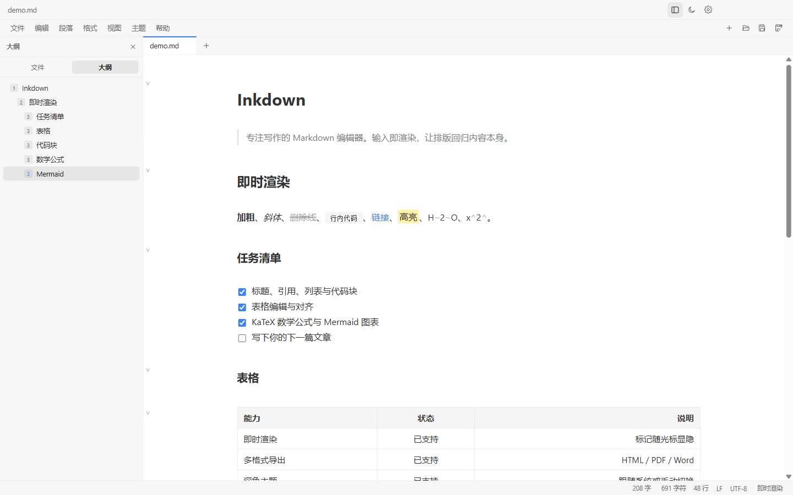
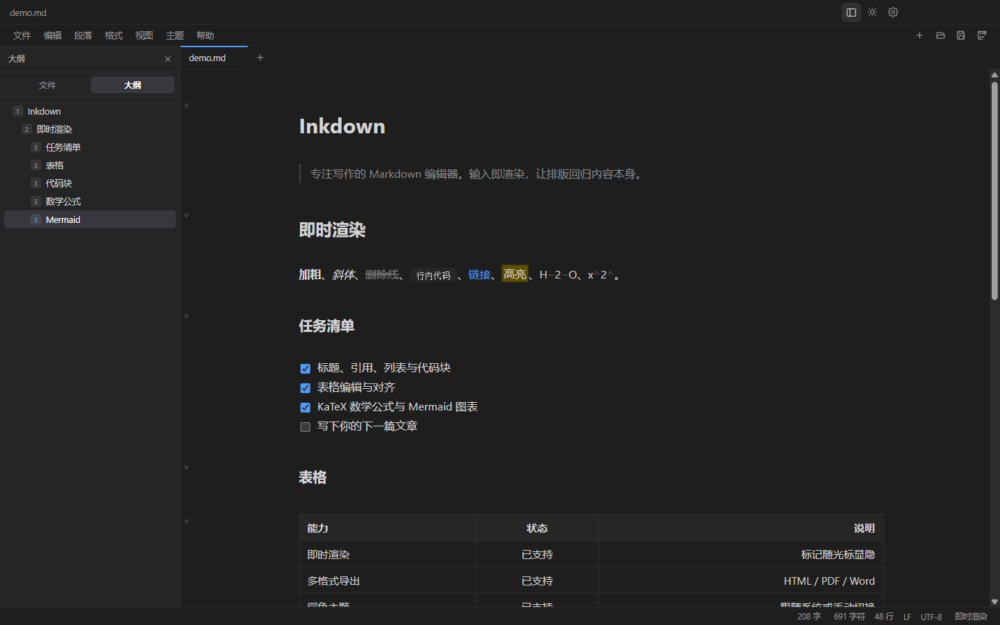

<div align="center">
  <picture>
    <source media="(prefers-color-scheme: dark)" srcset="build/logo-dark.png">
    
  </picture>

  <p>专注写作的 Markdown 编辑器。输入即渲染，让排版回归内容本身。</p>

  [](https://github.com/akiker233/Inkdown/actions/workflows/ci.yml)
  [](https://github.com/akiker233/Inkdown/releases/latest)
  [](LICENSE)
  [](https://github.com/akiker233/Inkdown/releases/latest)

  [下载](#下载与安装) · [功能特性](#功能特性) · [快捷键](#常用快捷键) · [本地开发](#本地开发) · [参与贡献](CONTRIBUTING.md)
</div>



## 简介

Inkdown 是一款面向 Windows 的桌面 Markdown 编辑器，目标是在本地提供一个接近 Typora 的沉浸式写作环境：没有编辑/预览分屏，Markdown 标记随光标显隐，输入的同时看到最终排版。

- **所见即所得**：标题、列表、表格、代码块、公式与图表即时渲染，光标移入时显示源码标记。
- **本地优先**：文档保存在本地，不需要账号，也不依赖云服务。
- **开源免费**：以 GPL-3.0 发布，欢迎参与贡献。

## 功能特性

### 写作体验

- 基于 CodeMirror 6 的即时渲染，保留 Markdown 源码的可编辑性。
- 源码模式（`Ctrl+/`）随时切换，方便批量修改。
- 专注模式（`F8`）、打字机模式（`F9`）、全屏（`F11`）。
- 侧栏大纲自动跟随当前段落，字数统计实时更新。
- 菜单栏与格式工具栏可显隐，常用格式一键应用。
- 中文 / English 界面，浅色、深色或跟随系统主题。

### Markdown 支持

- CommonMark 与 GFM：表格、任务列表、删除线、自动链接。
- 扩展语法：`==高亮==`、`H~2~O`、`x^2^`、脚注、目录。
- 代码块语法高亮（highlight.js），支持语言识别与混合渲染。
- KaTeX 行内与块级数学公式。
- Mermaid 流程图、时序图等图表，渲染失败时自动回退源码。
- 表格可视化编辑：增删行列、切换对齐、单元格源码回退。
- 图片拖拽与粘贴本地化，相对路径与本地资源协议支持。
- 标题折叠、列表续行、自动配对、查找替换。

### 文件与工作区

- 多标签页，每个标签独立维护撤销历史与编辑状态。
- 工作区文件树、快速打开（`Ctrl+P`）、打开文件夹。
- 自动保存（可关闭）、外部修改冲突提示、崩溃恢复。
- 关闭未保存文档时逐一确认，避免误丢内容。

### 导出

| 格式 | 说明 |
| --- | --- |
| HTML | 自包含单文件，内联样式与图片，可直接分享 |
| PDF | 基于系统打印管线，保留排版与分页 |
| PNG | 长图导出，适合社交平台与文档归档 |
| Word (.docx) | 优先调用 Pandoc，缺少时使用内置转换器 |
| LaTeX | 优先调用 Pandoc，缺少时使用内置转换 |
| ePub | 生成标准 ePub 3，优先调用 Pandoc |

导出 PDF / PNG / HTML 不依赖外部工具；Word / LaTeX / ePub 在检测到 Pandoc 时会优先使用它，否则自动降级并在完成后提示。

### Windows 桌面集成

- 关联 `.md`、`.markdown`、`.mdown`、`.mkd`、`.mdx`。
- 安装时可选择注册“使用 Inkdown 打开”文件右键菜单，也可在设置中随时开关。
- 提供“设为默认应用”引导，由用户在系统界面确认，不静默修改系统默认项。
- 启动时自动检查更新（默认关闭，可在设置中开启），也可随时手动检查；更新信息来自 GitHub Releases。
- 自定义顶部菜单栏与新建 / 打开 / 保存 / 另存为快捷按钮。

## 截图



## 下载与安装

前往 [Releases](https://github.com/akiker233/Inkdown/releases/latest) 下载最新版本：

| 安装包 | 适用场景 |
| --- | --- |
| `Inkdown-Setup-<version>-x64.exe` | 安装版，支持自定义安装目录、开始菜单与桌面快捷方式 |
| `Inkdown-Portable-<version>-x64.exe` | 便携版，解压即用，适合放在 U 盘或临时环境 |

系统要求：Windows 10 / 11 x64。

> 安装包未使用商业代码签名证书，Windows SmartScreen 可能提示“未知发布者”。校验值随每个 Release 一同发布。

## 常用快捷键

| 操作 | 快捷键 |
| --- | --- |
| 新建 / 打开 / 打开文件夹 | `Ctrl+N` / `Ctrl+O` / `Ctrl+Shift+O` |
| 快速打开 | `Ctrl+P` |
| 保存 / 另存为 | `Ctrl+S` / `Ctrl+Shift+S` |
| 关闭标签页 | `Ctrl+W` |
| 查找 / 替换 | `Ctrl+F` / `Ctrl+H` |
| 源码模式 | `Ctrl+/` |
| 专注模式 / 打字机模式 | `F8` / `F9` |
| 切换侧边栏 / 大纲 | `Ctrl+Shift+L` / `Ctrl+Shift+1` |
| 标题 1–6 / 正文 | `Ctrl+1` … `Ctrl+6` / `Ctrl+0` |
| 加粗 / 斜体 / 删除线 | `Ctrl+B` / `Ctrl+I` / `Alt+Shift+5` |
| 链接 / 图片 | `Ctrl+K` / `Ctrl+Shift+I` |
| 行内代码 / 代码块 | ``Ctrl+Shift+` `` / `Ctrl+Shift+K` |
| 引用 / 表格 / 公式块 | `Ctrl+Shift+Q` / `Ctrl+T` / `Ctrl+Shift+M` |
| 有序 / 无序 / 任务列表 | `Ctrl+Shift+[` / `Ctrl+Shift+]` / `Ctrl+Shift+X` |
| 全屏 | `F11` |
| 设置 | `Ctrl+,` |
| 放大 / 缩小 / 重置缩放 | `Ctrl+Shift+=` / `Ctrl+Shift+-` / `Ctrl+Shift+0` |

## 技术栈

| 层 | 技术 |
| --- | --- |
| 桌面运行时 | Electron 44 |
| 界面 | React 19、TypeScript 5.9、Zustand |
| 编辑器 | CodeMirror 6、Lezer Markdown |
| 构建 | electron-vite 6、Vite 7、electron-builder |
| Markdown | markdown-it、highlight.js |
| 公式与图表 | KaTeX、Mermaid |
| 测试 | Vitest、零依赖 CDP 端到端测试 |

## 项目结构

```text
src/
  main/       Electron 主进程：窗口、菜单、IPC、文件 / 导出 / 更新服务
  preload/    contextBridge 安全桥接与类型化 API
  renderer/   React 界面、CodeMirror 编辑器与导出渲染
  shared/     主进程与渲染进程共享的 IPC 契约和类型
docs/         README 截图与演示文档
scripts/      图标生成、CDP 截图与端到端测试
test/         手工验收用 Markdown 样张
.github/      CI、Issue 与 PR 模板
```

## 本地开发

环境要求：Node.js 24、npm、Windows 10 / 11。当前主要适配 Windows，Linux 与 macOS 尚未验证。

```bash
npm ci
npm run dev
```

常用命令：

| 命令 | 作用 |
| --- | --- |
| `npm run dev` | 启动开发模式 |
| `npm run typecheck` | 主进程与渲染进程类型检查 |
| `npm test` | 运行 Vitest 单元测试 |
| `npm run build` | 类型检查并构建到 `out/` |
| `npm run e2e` | 构建后运行开发版端到端测试 |
| `npm run dist` | 构建并生成 Windows 安装包到 `release/` |
| `npm run e2e:packaged` | 运行打包版端到端测试 |
| `npm run icon` | 重新生成应用图标 |
| `npm run logo` | 重新生成品牌 Logo |

提交代码前请至少运行 `npm run typecheck`、`npm test` 和 `npm run e2e`。详细约定见 [CONTRIBUTING.md](CONTRIBUTING.md)。

## 参与贡献

欢迎提交 Issue 和 Pull Request：

- 缺陷与功能建议请使用 [Issue 模板](https://github.com/akiker233/Inkdown/issues/new/choose)。
- 提交前请阅读 [贡献指南](CONTRIBUTING.md)。
- 安全问题请按 [安全策略](SECURITY.md) 私下报告，不要公开披露细节。

## 许可证

本项目以 [GNU General Public License v3.0](LICENSE) 发布。

## 致谢

Inkdown 站在以下开源项目之上：CodeMirror、Lezer、markdown-it、KaTeX、Mermaid、highlight.js、Electron、React、Zustand、Vite、electron-vite、electron-builder、Vitest。

---

## English

Inkdown is a Typora-like WYSIWYG Markdown editor for Windows, built with Electron, React, and CodeMirror 6. It renders Markdown inline as you type, keeps source markers visible around the cursor, and supports tabs, workspaces, outlines, KaTeX, Mermaid, tables, multi-format export, and Windows file associations.

Download the latest installer from [Releases](https://github.com/akiker233/Inkdown/releases/latest). The project is licensed under GPL-3.0. Contributions are welcome; see [CONTRIBUTING.md](CONTRIBUTING.md).
