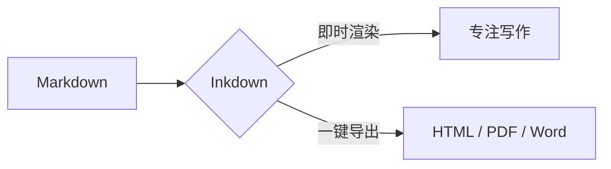

# Inkdown

> 专注写作的 Markdown 编辑器。输入即渲染，让排版回归内容本身。

## 即时渲染

**加粗**、*斜体*、~~删除线~~、`行内代码`、[链接](https://github.com/akiker233/Inkdown)、==高亮==、H~2~O、x^2^。

### 任务清单

- [x] 标题、引用、列表与代码块
- [x] 表格编辑与对齐
- [x] KaTeX 数学公式与 Mermaid 图表
- [ ] 写下你的下一篇文章

### 表格

| 能力 | 状态 | 说明 |
| :--- | :---: | ---: |
| 即时渲染 | 已支持 | 标记随光标显隐 |
| 多格式导出 | 已支持 | HTML / PDF / Word |
| 深色主题 | 已支持 | 跟随系统或手动切换 |

### 代码块

```ts
export function greeting(name: string): string {
  return `Hello, ${name}!`
}
```

### 数学公式

行内公式 $E = mc^2$，块级公式：

$$
\int_{-\infty}^{\infty} e^{-x^2}\,dx = \sqrt{\pi}
$$

### Mermaid


