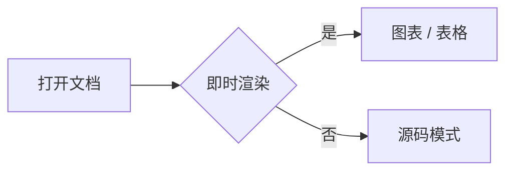
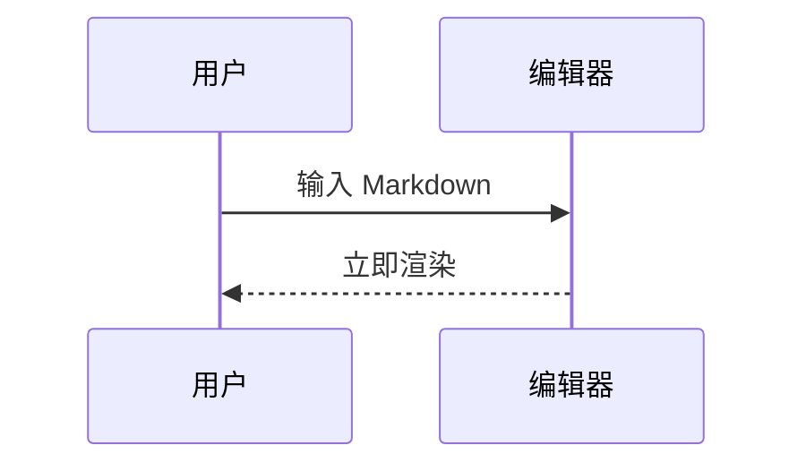

# M5 图表与面板验收

## Mermaid 流程图



## Mermaid 时序图



## 错误降级

```mermaid
flowchart LR
  A[未闭合
```

## 大纲跳转

### 三级标题 A

正文段落，用于测试聚焦模式与打字机模式。

### 三级标题 B

正文段落，用于测试大纲高亮跟随光标。

## 字数统计

> 中文字符、English words 123 与 emoji 😀。

## Setext 标题
=============

## 长文滚动测试

1. 第一段用于把文档撑高，验证打字机模式居中。
2. 第二段用于把文档撑高，验证打字机模式居中。
3. 第三段用于把文档撑高，验证打字机模式居中。
4. 第四段用于把文档撑高，验证打字机模式居中。
5. 第五段用于把文档撑高，验证打字机模式居中。
6. 第六段用于把文档撑高，验证打字机模式居中。
7. 第七段用于把文档撑高，验证打字机模式居中。
8. 第八段用于把文档撑高，验证打字机模式居中。
9. 第九段用于把文档撑高，验证打字机模式居中。
10. 第十段用于把文档撑高，验证打字机模式居中。
11. 第十一段用于把文档撑高，验证打字机模式居中。
12. 第十二段用于把文档撑高，验证打字机模式居中。
13. 第十三段用于把文档撑高，验证打字机模式居中。
14. 第十四段用于把文档撑高，验证打字机模式居中。
15. 第十五段用于把文档撑高，验证打字机模式居中。
16. 第十六段用于把文档撑高，验证打字机模式居中。
17. 第十七段用于把文档撑高，验证打字机模式居中。
18. 第十八段用于把文档撑高，验证打字机模式居中。
19. 第十九段用于把文档撑高，验证打字机模式居中。
20. 第二十段用于把文档撑高，验证打字机模式居中。
21. 第二十一段用于把文档撑高，验证打字机模式居中。
22. 第二十二段用于把文档撑高，验证打字机模式居中。
23. 第二十三段用于把文档撑高，验证打字机模式居中。
24. 第二十四段用于把文档撑高，验证打字机模式居中。
25. 第二十五段用于把文档撑高，验证打字机模式居中。
26. 第二十六段用于把文档撑高，验证打字机模式居中。
27. 第二十七段用于把文档撑高，验证打字机模式居中。
28. 第二十八段用于把文档撑高，验证打字机模式居中。
29. 第二十九段用于把文档撑高，验证打字机模式居中。
30. 第三十段用于把文档撑高，验证打字机模式居中。
