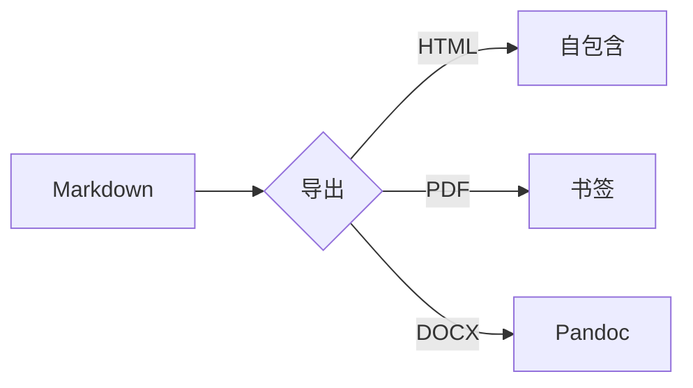

[TOC]

# Inkdown 导出验收

这是一段包含 **粗体**、*斜体*、~~删除线~~、`行内代码`、==高亮== 与 H~2~O 的中文段落。

## 数学公式

行内公式 $E = mc^2$，以及质能方程在块级形式：

$$
\int_{-\infty}^{\infty} e^{-x^2}\,dx = \sqrt{\pi}
$$

```math
\sum_{i=1}^{n} i = \frac{n(n+1)}{2}
```

## 代码与表格

```ts
export function greet(name: string): string {
  return `Hello, ${name}`
}
```

| 功能 | 状态 | 备注 |
| :--- | :---: | ---: |
| HTML | 完成 | 自包含 |
| PDF | 完成 | 书签 + 页码 |
| DOCX | 完成 | Pandoc / 内置 |

## 任务与脚注

- [x] 行内即时渲染
- [ ] 导出全部格式
- [ ] 跨平台打包

这里有一个脚注引用[^1]。

[^1]: 脚注正文会出现在文档末尾。

## Mermaid



## 图片


\pagebreak

## 第二页

分页符之后的章节。
